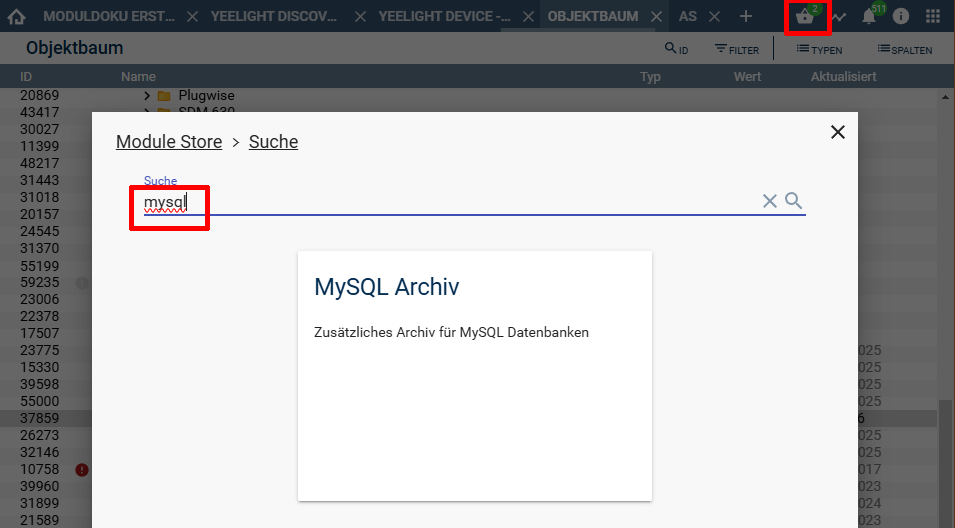
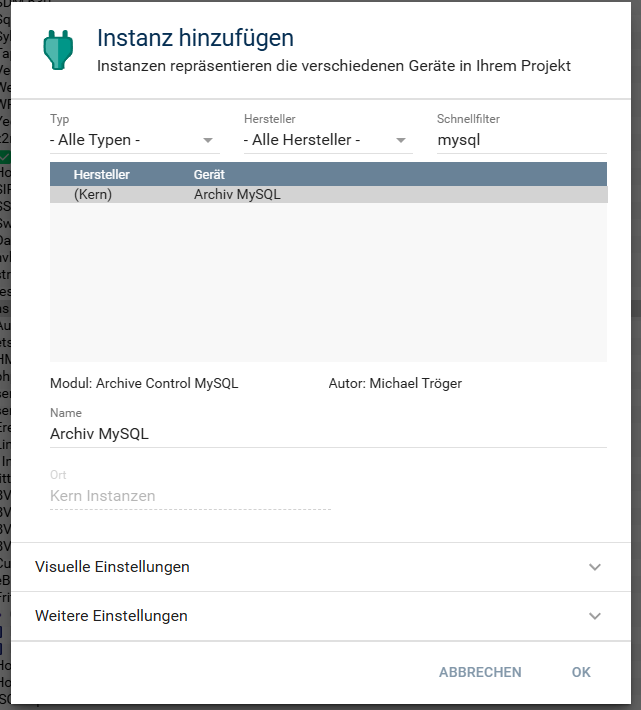
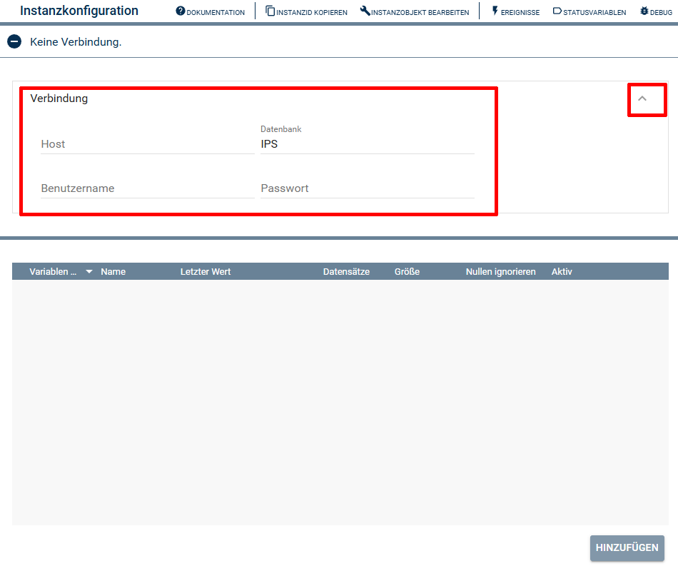
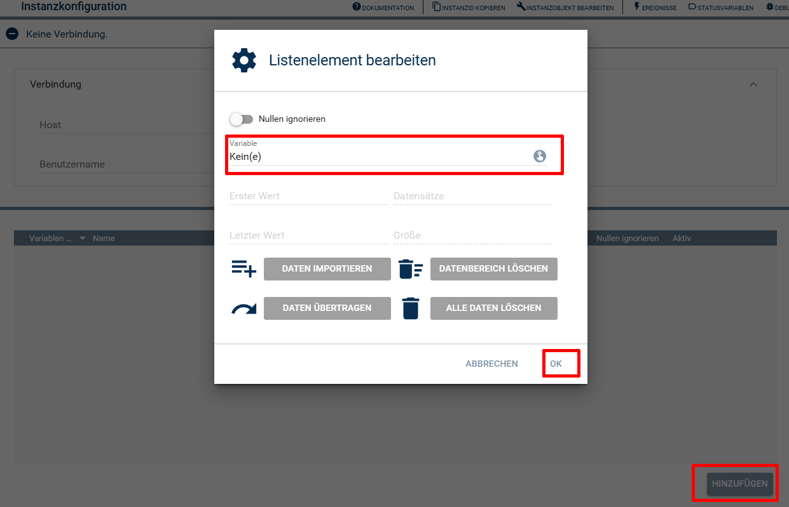

 

  

  

# Symcon-Modul: MySQL Archiv  <!-- omit in toc -->

Zusätzliches Archiv für MySQL Datenbanken.

## Inhaltsverzeichnis <!-- omit in toc -->

- [1. Funktionsumfang](#1-funktionsumfang)
- [2. Voraussetzungen](#2-voraussetzungen)
- [3. Software-Installation](#3-software-installation)
- [4. Vorbereitungen](#4-vorbereitungen)
- [5. Einrichten der Instanz in Symcon](#5-einrichten-der-instanz-in-symcon)
- [6. PHP-Funktionsreferenz](#6-php-funktionsreferenz)
- [7. Konfiguration](#7-konfiguration)
- [8. Anhang](#8-anhang)
  - [1. GUID der Module](#1-guid-der-module)
  - [2. Changelog](#2-changelog)
- [9. Spenden](#9-spenden)
- [10. Lizenz](#10-lizenz)

## 1. Funktionsumfang

Variablenveränderungen in einer MySQL-Datenbank speichern.  
Auslesen mit `ACMYSQL_*` PHP-Funktionen (kompatibel mit den `AC_*` Befehlen).  

**Achtung:**  
  Dieses `"Archive Control"` ersetzt nicht das Original in Symcon.  
  Es wird **nicht** zur Visualisierung der Symcon eigenen Graphen genutzt.  
  Ebenso kann das Logging-Verhalten **nicht** über die Einstellungen der Variable angepasst werden, sondern nur in der Instanz `Archiv MySQL`.  
  Der Typ Zähler ist nicht verfügbar.

  Um die gespeicherten Daten darzustellen, müssen Umsetzungen von dritten (wie z.B. Highcharts, Grafana, usw...) genutzt werden.  
  Eine angepasste Highcharts.ips.php ist unter 'docs' beigefügt und kann über die Konfiguration der Instanz in den Objektbaum kopiert werden.  

## 2. Voraussetzungen

- Symcon ab Version 8.1
- MySQL Server

## 3. Software-Installation

Über den `Module-Store` in Symcon das Modul `MySQL Archiv` hinzufügen.  
**Bei kommerzieller Nutzung (z.B. als Errichter oder Integrator) wenden Sie sich bitte an den Autor.**  

## 4. Vorbereitungen

- Der MySQL-Server muss von Symcon aus erreichbar sein.  
- Es muss ein Benutzer mit allen erforderlichen Rechten vorhanden sein. (Daten & Struktur)  

## 5. Einrichten der Instanz in Symcon

- Den Dialog 'Instanz hinzufügen' öffnen.  
- In den Schnellfilter MySQL eingeben.  

- Den Eintrag 'Archiv MySQL' wählen und mit OK bestätigen.  
- Im folgenden Dialog müssen jetzt erst die Zugangsdaten zum MySQL-Server unter `Verbindung` eingegeben werden.  

- Die zu loggenden Variablen müssen über den Button 'hinzufügen' eingetragen werden.  

## 6. PHP-Funktionsreferenz  

Es sind fast alle Symcon Befehle des Original Archive-Control vorhanden.  
Der Prefix muss nur von `AC_` gegen `ACMYSQL_` ersetzt werden.  
Nicht unterstützte Funktionen, welche immer 0 oder true zurückliefern:

- `ACMYSQL_GetAggregationType(int $InstanceID, int $VariableID)`
- `ACMYSQL_GetGraphStatus(int $InstanceID, int $VariableID)`
- `ACMYSQL_ReAggregateVariable(int $InstanceID, int $VariableID)`
- `ACMYSQL_SetAggregationType(int $InstanceID, int $VariableID, int $Aggregationstyp)`
- `ACMYSQL_SetCompaction(int $InstanceID, int $VariableID, int $MonatsVersatz, int $Verdichtungstyp)`
- `ACMYSQL_SetGraphStatus(int $InstanceID, int $VariableID, bool $Aktiv)`

## 7. Konfiguration

| Name         | Eigenschaft | Typ     | Standardwert | Funktion                          |
| :----------- | :---------- | :------ | :----------- | :-------------------------------- |
| Host         | Host        | string  |              | Hostname / IP-Adresse             |
| Datenbank    | Database    | string  | ips          | Name der Datenbank                |
| Benutzername | Username    | integer |              | Benutzername MySQL                |
| Passwort     | Password    | string  |              | Passwort MySQL                    |

## 8. Anhang

### 1. GUID der Module

|         Modul         |  Typ   | Prefix  |                  GUID                  |
| :-------------------: | :----: | :-----: | :------------------------------------: |
| Archive Control MySQL | Device | ACMYSQL | {FDCB334A-AFFF-4785-9596-D380252CEE4E} |

### 2. Changelog

**Version 3.51:**  

> [!IMPORTANT]  
> Vor diesem Update wurden Werte von Variablen vom Typ Float und String teilweise falsch in die Datenbank geschrieben (Nachkommastellen bzw. Texte gingen verloren). Bereits gespeicherte Werte werden nicht korrigiert.  

- Fehlende Tabellen werden beim ersten Schreiben eines Wertes automatisch angelegt (z.B. nach einem Wechsel der Datenbank).  
- Datenbanknamen mit Sonderzeichen (z.B. Bindestrich oder Leerzeichen) werden unterstützt.  
- Nachkommastellen von Float-Variablen gingen beim Loggen teilweise verloren.  
- String-Variablen wurden teilweise nicht als Text gespeichert.  
- Die Liste der archivierten Variablen konnte falsche oder verkürzte Variablen-IDs enthalten, wenn sich weitere Tabellen in der Datenbank befanden.  
- Fehler beim Abfragen oder Anlegen von Tabellen führten zu PHP-Warnungen.  

**Version 3.50:**  

- Version für Symcon 8.1  
- Unterstützung für ignore zeros hinzugefügt.
- Umstellung auf dynamisches Konfigurationsformular.  
- Schnelleres Laden der Konfiguration durch asynchrone Abfrage der Tabellen.
- CSV Import Funktion über Konfigurationsformular hinzugefügt.  
- Datentransfer auf andere Variable im Konfigurationsformular hinzugefügt.  
- Löschen von Daten eines Zeitbereiches im Konfigurationsformular hinzugefügt.
- Löschen aller Daten und Deaktivieren des Loggings im Konfigurationsformular hinzugefügt.
- Diverse Fehlerbehebungen.
- Übersetzungen ergänzt und verbessert.

**Version 3.40:**  

- Version für Symcon 7.0  

**Version 3.35:**  

- Das Anzeigen der Konfiguration konnte fehlschlagen, wenn in einer Tabelle keine Werte vorhanden waren.  
- ACMYSQL_GetAggregationVariables konnte fehlschlagen, wenn in einer Tabelle keine Werte vorhanden waren.  
- ACMYSQL_ChangeVariableID konnte fehlschlagen,wenn in einer Tabelle keine Werte vorhanden waren.  
- ACMYSQL_GetLoggedValues konnte fehlschlagen,wenn in einer Tabelle keine Werte vorhanden waren.  
- ACMYSQL_GetAggregatedValues konnte fehlschlagen,wenn in einer Tabelle keine Werte vorhanden waren.  

**Version 3.31:**  

- Fix für defekte 3.20 Version.  

**Version 3.20:**  

- Release für Symcon 5.1 und den Module-Store  

**Version 3.10:**  

- Buffer Tread-Safe mit Semaphore abgesichert.  

**Version 3.00:**  

- Loggen der Daten von Nachrichtenschlange entkoppelt.  

**Version 2.50:**  

- Anpassungen für Symcon 5.1  

**Version 2.00:**  

- Anpassungen für Symcon 5.0
- Modul intern umgebaut
- Konfiguration für WebConsole verbessert  

**Version 1.02:**  

- Fixes für Symcon 5.0  

**Version 1.01:**  

- Erstes offizielles Release

## 9. Spenden  
  
  Die Library ist für die nicht kommerzielle Nutzung kostenlos, Schenkungen als Unterstützung für den Autor werden hier akzeptiert:  

  

## 10. Lizenz

  IPS-Modul:  
  [Custom NC-SA](LICENSE)  
